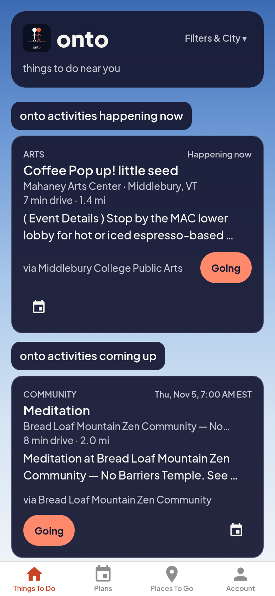
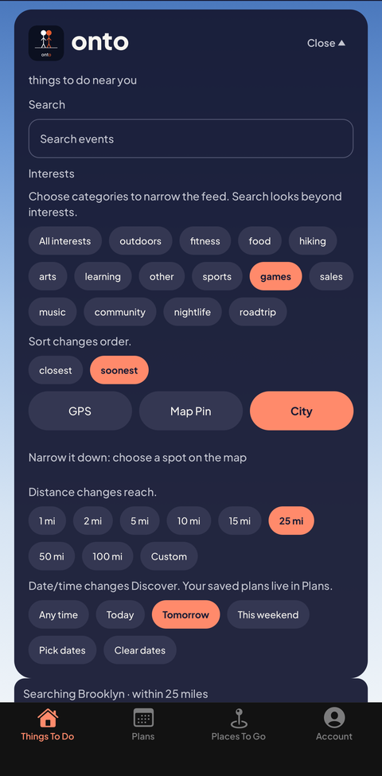
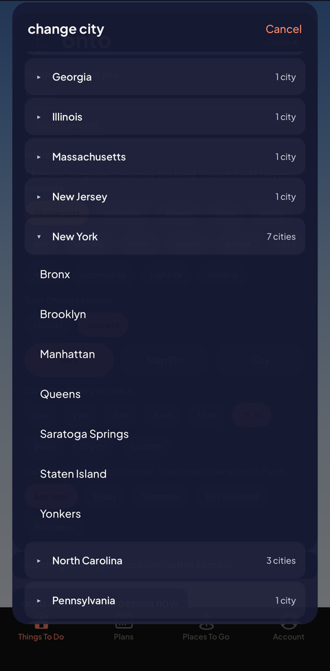
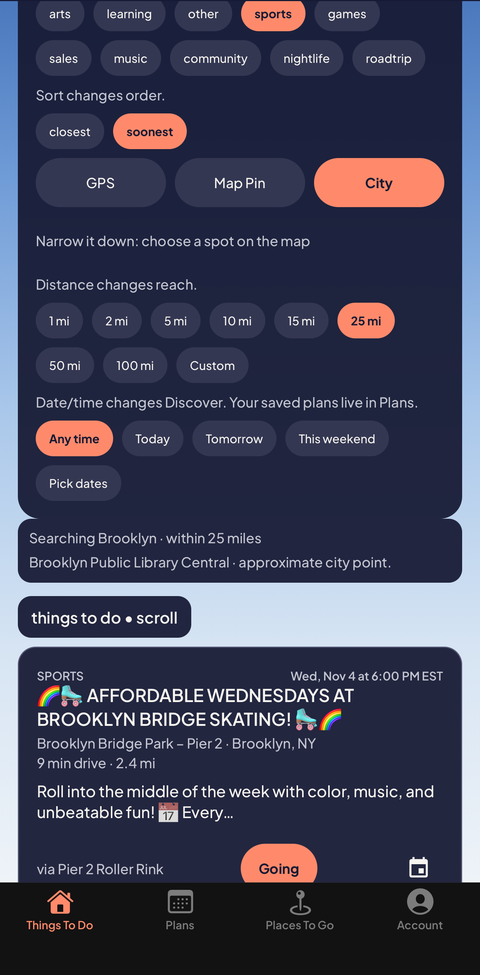
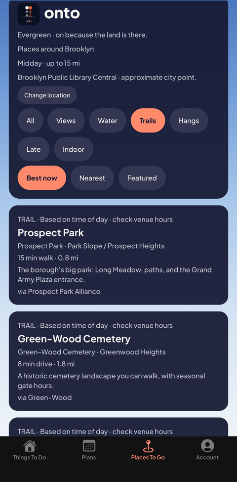
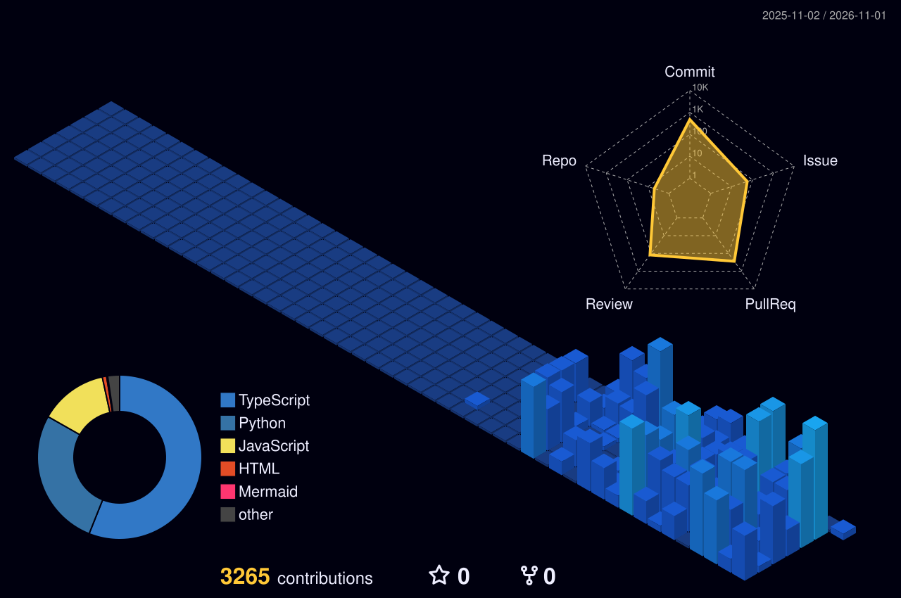

# James Richmond

full-stack developer. i like building things regular people can actually use, and then building the unglamorous plumbing underneath so they keep working when i'm not watching :: typescript, react / react native, node, postgres, python

 

## featured work

| | project | what it is | stack |
|---|---|---|---|
| 1 | **[onto](https://github.com/JamesTRichmond/onto-events)** · [live]([https://onto.events](https://apps.apple.com/us/app/id6808894038) | a free web app that shows you what's going on around you right now, pulled straight from the venues' own calendars. no account, no ads, and your location never leaves your phone | React Native / Expo (web), Expo Router, Supabase + RLS, Leaflet, Jest |
| 2 | **[Middlebury Campus RPG](https://github.com/JamesTRichmond/middlebury-campus-rpg)**[Play the Demo](https://campus-rpg-demo.pages.dev/)** | an unofficial orientation game for Middlebury. you ride the train in, build your character (wheelchair included), find your dorm, and sit in a class where the teacher can only say what's actually in the lesson | React 19, Vite, Zod content graph, Vitest, Playwright, Figma-first |
| 3 | **[Small Cheap Experiments](https://github.com/JamesTRichmond/small-cheap-experiments)** | before an AI agent does something it can't take back, like issuing a refund, this checks whether what it says it's doing matches what it actually does, and keeps a tamper-evident record of the whole thing | Python, JSON Schema, pytest |
| 4 | **[Cloud of Electrons](https://github.com/JamesTRichmond/cloud-of-electrons)** · [live](https://jamestrichmond.com) | my site. my poems pull themselves together out of a cloud of particles, one at a time, and then drift back apart | WebGL, JavaScript, Python build tools |
| 5 | **[Otter Creek Homelab](https://github.com/JamesTRichmond/otter-creek-homelab)** | the lab in my house where my local models and coding agents live, written up by what each machine does rather than where it lives | Proxmox, UniFi, Ollama / MLX, Python |

## now shipping: onto

<table>
<tr>
<td valign="top">
 
Tap the screenshot to open onto.
</td>
<td valign="top" align="center">
 
 
 
 
</td>
</tr>
</table>

- it installs from your browser like an app and works offline. you never have to make an account or look at an ad.
- your exact location stays on your phone. there's a test whose whole job is to fail if a request ever tries to carry it out.
- events get pulled from venue calendars in 20+ metro areas, cleaned up and de-duplicated, and the database rules get tested the same way the code does.
- built under AgentiCubed LLC. **[Open onto](https://onto.events)** · [source](https://github.com/JamesTRichmond/onto-events)

## honorable mentions

| project | one line | status |
|---|---|---|
| [HLS Aurora](https://github.com/JamesTRichmond/hls-aurora) | a walkable space station with two complete stories laid over the same floor: the comforting one the crew is told, and the one the people running the study actually see | prototype |
| [AgentiCubed / A3](https://github.com/AgentiCubed/A3) | my agent orchestration platform: task graphs, separate doers and checkers, and it fails closed when the output doesn't hold up. plenty of people have built this since, but i built it before it was a category | active |
| [BannerBanner](https://github.com/AgentiCubed/bannerbanner) | a Chrome extension that gets rid of cookie banners, but only on the sites you've told it to, because blindly clicking accept on everything is its own privacy problem | built, pre-store |
| [Preincarnation](https://github.com/JamesTRichmond/preincarnation) | an RPG set in Vermont where dying is just the next chapter | active |
| [BoomerEZ](https://agenticubed.github.io/BoomerEZ/) | free one-file programs for people who were never taught the computer words and shouldn't have to be | live |
| Verbal Kombat | a fighting game where good arguments land hits and fallacies blow up in your face. underneath, it's a harness for pitting AI debaters against each other | private |
| Wild Mates | a claymation field guide to how animals find a mate. the visual tests fail if a single pixel drifts | private |

## stack

TypeScript · JavaScript · Python · SQL &nbsp;|&nbsp; React 19 · React Native / Expo · Vite · TanStack Start · Tailwind · Radix &nbsp;|&nbsp; Node · Supabase / Postgres (RLS) · Kysely · Deno edge functions &nbsp;|&nbsp; Jest · Vitest · Playwright · pytest &nbsp;|&nbsp; Cloudflare Pages · Vercel · GitHub Actions &nbsp;|&nbsp; Figma &nbsp;|&nbsp; Proxmox · Ollama / MLX

## background

- served in the U.S. Air Force as a nuclear weapons technician
- taught for more than eight years in Florida and Vermont
- territory sales after that, and now software
- M.S., IT & Cybersecurity; graduate certificates in AI, Data Science and Digital Forensics

[jamestrichmond.com](https://jamestrichmond.com) · [LinkedIn](https://www.linkedin.com/in/jamestrichmond)

---

## Open Field

A spoken sit, on its own page. One button. Watch the thoughts go by.

[Sit](https://beacon-lunar-yonder-lark.grok.me/)

## GitHub Stats

  
  

## Guestbook

if you stopped by, leave a note: [open an issue](https://github.com/JamesTRichmond/JamesTRichmond/issues/new?template=guestbook.yml) and a bot will clean it up, add you to the wall, thank you, and close the issue on its own, so nobody has to babysit it.

and if you'd rather try to break it than sign it, go for it. [the same sanitizer runs in your browser here](https://jamestrichmond.com/security/).

<!--START_SECTION:guestbook-->
- **[@JamesTRichmond](https://github.com/JamesTRichmond)** — Real end to end test after the Issues permission fix. · 2026-09-08
<!--END_SECTION:guestbook-->

<!-- Don't Try. — Bukowski -->

## 3D Contribution Graph

  

